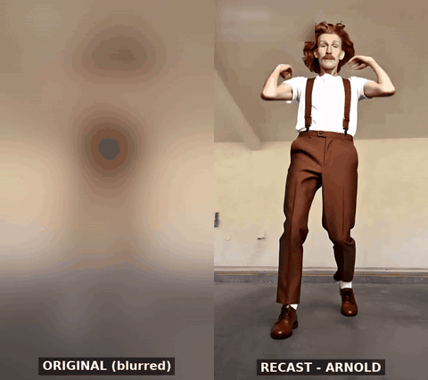
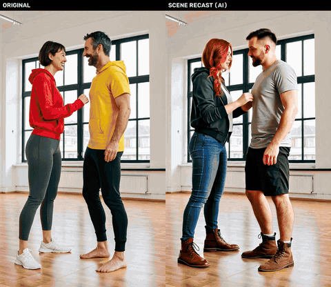

# Recast Studio



*Left: the original clip, blurred for privacy. Right: the same clip recast as Arnold Sparrenjäger, a fictional
character. Same room, same camera, same moves, same timing.*

**Swap the person in a real video for your character.** The scene, the camera move, the timing and the audio stay
real. Only the person changes.

## New in v4: Scene Recast



*Recast every person in a multi-person, multi-shot clip. Left: our own AI-generated test clip (no real people).
Right: both dancers and the close-up recast as two other characters. Same room, same camera, same moves.*

## What it does

You open a page in your browser and give it two things:

1. **the original video**, as an upload or a link
2. **a character image**: a photo, a render or a drawing of one person

You press Recast, and you get back the same video with your character performing it, ready to download.

## Features

- **Scene Recast (new in v4).** Recast every person in a multi-person, multi-shot clip with your own characters
  while the real background and camera stay. Automatic shot detection, every person tracked in every frame (no original
  person can leak through), identities matched across cuts, one line per person in a cast file.
- **Crew mode (v3).** Turn your renders into a synchronized dance crew on one stage: a lead at the point,
  mirrored clones in formation, feet planted, contact shadows and floor reflections. CPU only - no extra GPU time.
- **Upload or link.** Drop a file or paste a video link; it fetches it, keeps up to 2 minutes (long videos render as ~30-second
  segments that are stitched back together) and normalises it.
- **Auto full body.** Only have a chest-up portrait of your character? It notices, and generates a full-body
  version of the same person first (Qwen-Image-Edit-2509), so the legs, trousers and shoes are your character's,
  not the original person's.
- **No hair bleed, no smudge.** The original person's flying hair and edges are painted out with a clean
  background built from the clip itself, and the new person is drawn into a cut-out shaped like them.
- **The real scene.** Wan2.2-Animate-14B in "replace" mode keeps the original background and camera and relights
  your character to match. The original audio is put back on the result.
- **One machine or two.** Run everything on one Windows or Linux PC with an NVIDIA GPU, or keep the web page on
  one machine and send the rendering to a GPU box over ssh.
- **Checks before it spends GPU time.** A preflight names any missing custom node or model file. A dry-run mode
  tests the whole pipeline without rendering.
- **Plays nice with a shared GPU.** Optional hooks wait for other apps on the same card instead of fighting them
  for memory.

## How it works

```
 original video ──► normalise ──► analyse ────────────────────────────► render ──────► finish
 (upload / link)    16 fps, 720p,   • is the character full-body?          Wan2.2-Animate  trim to length,
                    ≤ 30 s,          • clean plate of the empty scene       14B "replace"   original audio
                    audio kept       • black cut-out where the new person   in ComfyUI      back on
                                       goes (still camera)
 character image ─► fit to frame ─► portrait only? ─► generate a full-body version first
```

1. The video is normalised and the character image fitted to the frame.
2. A pose model checks whether the character shows knees and ankles. If not, Qwen-Image-Edit draws the full body.
3. The clip is analysed frame by frame: where the original person is, and what the room looks like without them.
4. ComfyUI renders the new person into the scene, following the original's body and face movement.
5. The result is trimmed to the original length and gets the original audio back.

## Requirements

- An NVIDIA GPU. Measured on a 32 GB card: about 110 seconds of GPU time per second of 720p video, so an
  11-second clip takes about 20 minutes. Smaller cards can trade speed for memory.
- 64 GB of system RAM recommended.
- ComfyUI with five custom node packs, and about 62 GB of open model weights.
- Python 3.10+ and ffmpeg. Windows or Linux.
- Clips up to 2 minutes. One person in the shot and a still camera give the best results; a moving camera falls
  back to a simpler mask.

## Get it

**The full source, the ComfyUI workflows and the install guide are on Patreon for paid members:**
**[Recast Studio Pro v4 - one-time purchase](https://www.patreon.com/warboy176/posts/recast-studio-175871279)** · members get every update:
**[v4 release post](https://www.patreon.com/warboy176/posts/recast-studio-v4-176229545)** · [patreon.com/warboy176](https://www.patreon.com/warboy176)

The install guide lists every model file with its download link and folder, the custom nodes and the versions it
was tested with, single-machine and render-host setup, VRAM notes and troubleshooting.

## Use it responsibly

Only recast footage you own or have permission to use. Don't put a real person's likeness into a video without
their consent, don't impersonate anyone, and don't pass a recast off as real footage. Label AI-made videos where
you publish them.

## License

The text of this README is MIT licensed (see LICENSE). The demo animations are for illustration only. The Recast
Studio Pro source is not in this repository and is licensed separately.
